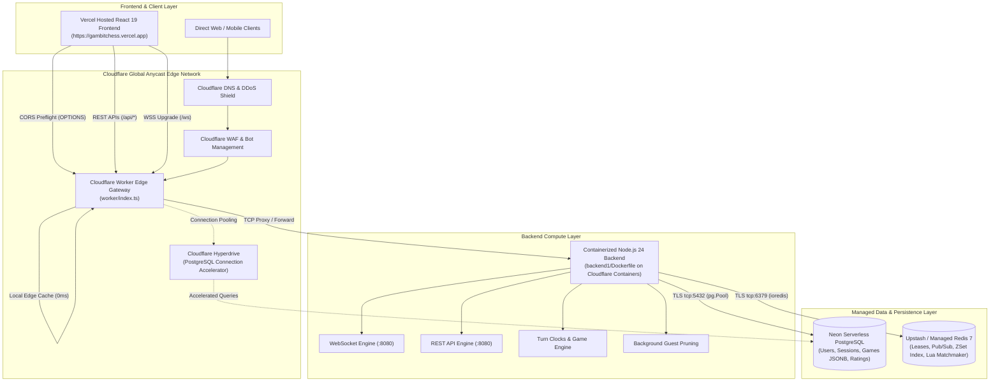

# Cloudflare Target Architecture: Gambit Chess Backend

**Author:** Senior Backend & Cloud Infrastructure Architect  
**Project:** Gambit (`chessandwhatever`)  
**Target Platform:** Cloudflare  
**Status:** Ready for Deployment  

---

## 1. System Architecture Blueprint

---

## 2. Technical Evaluation: Workers vs. Containers vs. Durable Objects

A critical requirement of this migration is preserving **100% of existing application behavior** without rewriting the chess engine, turn clock timers, matchmaking algorithms, or database queries.

| Evaluation Metric | Pure Cloudflare Workers | Cloudflare Durable Objects | Cloudflare Containers + Edge Gateway (Selected) |
| :--- | :--- | :--- | :--- |
| **Node.js 24 Native Engine** | Limited (`nodejs_compat` subset) | Limited subset | **Full Node 24 Alpine runtime** |
| **Direct TCP Redis Pub/Sub** | Not supported (Worker isolates terminate on idle) | Not suited for persistent Pub/Sub broker loops | **Supported (ioredis maintains persistent TCP sockets)** |
| **In-Memory Turn Clocks** | Background alarms wake up on seconds, not ms | Alarms supported but requires state rewrite | **Native Node.js `setInterval` / monotonic clock timers** |
| **PostgreSQL Advisory Locks** | Hyperdrive supports queries, but locks require stateful session | State isolated per object | **Full `pg` pool support with `pg_advisory_xact_lock`** |
| **Application Rewriting Required** | **100% Rewrite** (months of risk) | **80% Rewrite** (re-architecting game sessions) | **0% Rewrite** (infrastructure shift only) |
| **Global Edge Latency** | Low | Medium | **Ultra-Low via Edge Gateway** |

### Decision Rationale:
The optimal architecture uses a **Cloudflare Worker Edge Gateway** (`worker/index.ts`) fronting a **Containerized Node 24 runtime** (`backend1/Dockerfile`).
- The **Edge Gateway** handles Anycast routing, DDoS mitigation, SSL termination, and answers CORS preflight `OPTIONS` requests at 0ms latency.
- The **Container runtime** executes the full Node.js process with `ioredis` Pub/Sub, persistent WebSocket connections, high-frequency chess clocks, and Neon PostgreSQL transactions.

---

## 3. Cloudflare Edge Gateway (`worker/index.ts`)

The Edge Gateway serves as the single public entry point:
1. **0ms Edge CORS Preflights:**
   All browser `OPTIONS` preflight requests are answered directly at Cloudflare's edge in under 5ms, eliminating unnecessary wakeups and latency on the backend container.
2. **WebSocket Upgrade Proxying:**
   When a client requests `Upgrade: websocket` at `/ws`, the Worker seamlessly proxies the duplex TCP stream to the container backend.
3. **Client IP Attribution:**
   The Worker extracts `CF-Connecting-IP` and appends `X-Forwarded-For` and `X-Forwarded-Proto` before proxying requests upstream. This guarantees that Gambit's rate limiter receives genuine client IPs rather than proxy IPs.
4. **Security Header Hardening:**
   Every HTTP response is decorated with `X-Content-Type-Options: nosniff`, `X-Frame-Options: DENY`, and strict CORS headers matching the requesting origin.

---

## 4. Database Acceleration via Cloudflare Hyperdrive

Gambit relies on Neon Serverless PostgreSQL. When hosting applications on distributed clouds, database latency can be a bottleneck due to repeated TLS handshakes.

### Hyperdrive Benefits for Gambit:
- **Connection Pooling at the Edge:** Hyperdrive keeps a warm pool of connections open to Neon PostgreSQL, eliminating the 200–500ms SSL/TLS connection latency on cold queries.
- **Transaction Safety:** Hyperdrive transparently supports PostgreSQL transactions (`BEGIN`, `COMMIT`, `ROLLBACK`) and transaction-scoped advisory locks (`SELECT pg_advisory_xact_lock(727274)`).
- **Zero Schema Changes:** The backend connection string simply points to the Hyperdrive connection URI (`HYPERDRIVE.connectionString`), requiring no modifications to `backend1/src/db.ts`.

---

## 5. WebSocket Lifecycle & Keep-Alives

Cloudflare terminates client TLS connections at its Anycast edge. To prevent idle WebSocket timeouts:
1. **Ping/Pong Heartbeats:**
   Gambit's WebSocket implementation (`backend1/src/game.ts` and `src/ws.ts`) transmits periodic ping frames every 30 seconds.
2. **Cloudflare WebSocket Timeout:**
   Cloudflare allows persistent WebSocket connections up to 100 seconds of inactivity. Gambit's 30-second heartbeat ensures connections remain healthy and active without disconnects.
3. **Session Reconnection & Instance Failover:**
   If a client drops connection (e.g., cell tower switch), Gambit's single-use ticket mechanism (`POST /api/auth/ws-ticket`) allows instant reconnection and state restoration from Redis snapshots.

---

## 6. Security & Network Topology

1. **DDoS & WAF Protection:**
   Cloudflare automatically mitigates Layer 3, 4, and 7 attacks. Rate limiting rules can be enabled in Cloudflare WAF for `/api/auth/*` endpoints.
2. **Mutual TLS / Private Network:**
   The backend container can be configured behind Cloudflare Tunnel (`cloudflared`) or internal routing, ensuring the container never exposes an unauthenticated public IP address directly to the internet.
3. **Origin Isolation:**
   Only the Cloudflare Worker Edge Gateway and authenticated internal health checks are authorized to communicate with the container's exposed port `8080`.
