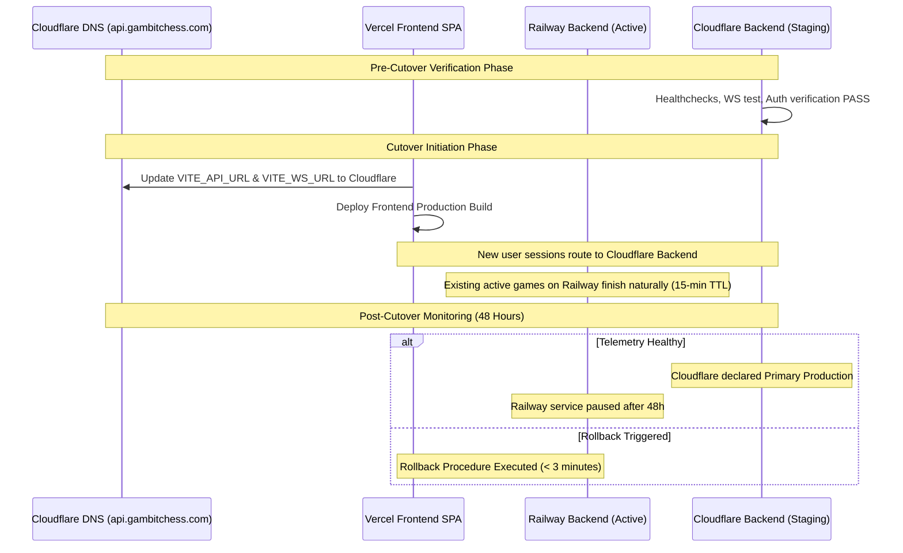

# Migration Rollback Plan & Business Continuity: Gambit Backend

**Project:** Gambit (`chessandwhatever`)  
**Scope:** Production Migration Safety, Rollback Triggers & Recovery Procedures  
**Objective:** Zero Data Loss, Predictable Failure Mitigation, and Continuous Game Availability  

---

## 1. Safety Architecture & Principles

This migration follows a **zero-downtime parallel deployment model**:
1. **Railway Remains Untouched:**
   During migration preparation and initial deployment, Railway services are not deleted or modified. The Railway backend remains fully operational as a standby fallback.
2. **Neon PostgreSQL Continuity:**
   Both Railway and Cloudflare backend instances connect to the exact same Neon PostgreSQL database. There are no divergent databases, schema downgrades, or data sync scripts required. Any games played on Cloudflare will persist in Neon even if a rollback is triggered.
3. **Independent Redis Namespaces:**
   The Cloudflare backend uses `REDIS_PREFIX=gambit:prod:cf:` or its own dedicated Upstash Redis instance, ensuring zero key collisions or race conditions with Railway.

---

## 2. Cutover Protocol



---

## 3. Rollback Triggers

An immediate rollback to Railway must be initiated if any of the following conditions occur within 48 hours of cutover:

1. **HTTP Error Spike:** 5xx error rate exceeds **1.0%** over a 5-minute rolling window.
2. **WebSocket Handshake Failures:** WebSocket connection failure rate exceeds **2.0%**.
3. **Unexpected Game Clock Halts:** Redis lease acquisition errors causing active game timers to freeze.
4. **Authentication / OAuth Degradation:** Google OAuth or password reset token verification failures exceeding 0.5%.
5. **Database Latency Spike:** Neon query p95 latency exceeds **500ms** continuously.

---

## 4. Step-by-Step Rollback Execution Procedure

If a rollback trigger is met, execute these steps immediately:

### Step 1: Revert Frontend Environment Variables in Vercel (< 2 minutes)
1. Open [Vercel Dashboard](https://vercel.com/) > `gambitchess` > **Settings** > **Environment Variables**.
2. Revert values to the Railway backend:
   ```env
   VITE_API_URL=https://<YOUR_RAILWAY_APP>.up.railway.app
   VITE_WS_URL=wss://<YOUR_RAILWAY_APP>.up.railway.app/ws
   ```
3. Navigate to **Deployments** > Select the latest stable pre-cutover deployment > Click **Promote to Production** (instant 5-second rollback).

### Step 2: Fallback DNS Record (If Custom Domain was Migrated) (< 1 minute)
If `api.gambitchess.com` was routed directly to Cloudflare:
1. In Cloudflare DNS, edit CNAME `api`.
2. Change target from Cloudflare Worker to `<YOUR_RAILWAY_APP>.up.railway.app`.
3. Set proxy status to **DNS Only** (or Proxied) to immediately point traffic back to Railway.

### Step 3: Validate Restored Health on Railway (< 1 minute)
```bash
# Verify Railway HTTP health
curl -I https://<YOUR_RAILWAY_APP>.up.railway.app/api/health

# Verify Railway WebSocket endpoint
npx wscat -c "wss://<YOUR_RAILWAY_APP>.up.railway.app/ws"
```

---

## 5. Data Integrity Guarantees

| Data Category | Rollback Impact | Recovery Action Required |
| :--- | :--- | :--- |
| **User Accounts & Passwords** | **Zero Loss.** Stored directly in shared Neon PostgreSQL. | None. |
| **Completed Games & Elo Ratings** | **Zero Loss.** Persisted via transactional SQL with advisory locks. | None. |
| **Active Games in Progress** | In-flight games active at the exact second of rollback may abort cleanly. | Abandon timeout automatically aborts or refunds clock after 60s without rating penalty. |
| **Session Tokens** | Valid sessions continue working if `AUTH_SECRET` is identical on Railway and Cloudflare. | If secrets differ, users simply re-login. |

---

## 6. Post-Rollback Forensic Checklist

1. Export Cloudflare Worker logs via Cloudflare Dashboard or `wrangler tail`.
2. Inspect Cloudflare Container log streams for unhandled exceptions or connection pool exhaustion.
3. Check Upstash Redis metrics for command limits, memory caps, or TLS handshake latency.
4. Check Neon PostgreSQL console for connection count exhaustion or slow query logs.
5. Document root cause and resolve in staging before scheduling re-attempt.
