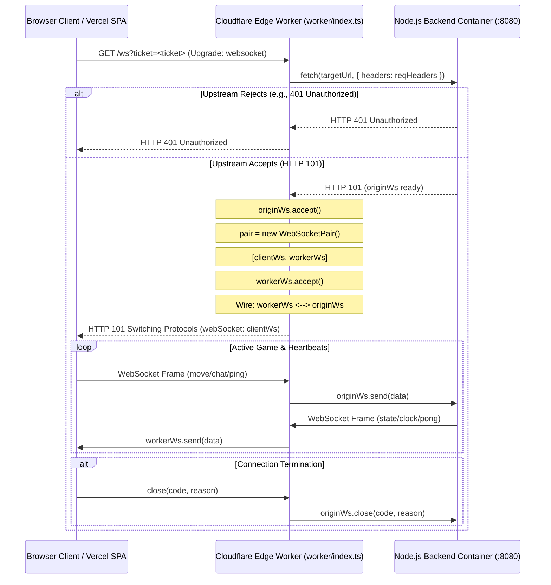

# Cloudflare Migration Audit Fix Implementation Report

**Repository:** `codealisha99/chessandwhatever`  
**Date:** 2026-11-21  
**Scope:** Remediation of 3 Approved Findings from `POST_MIGRATION_AUDIT.md`  

---

## 1. Findings Addressed & Root Causes

### Finding 1 (CRITICAL): WebSocket Proxying Failure
- **Root Cause:** In Cloudflare Workers, proxying WebSockets to an external origin cannot be achieved by simply returning `fetch(targetUrl)` with an `Upgrade` header. While `fetch()` creates an upstream WebSocket on `response.webSocket`, the client socket is not connected to it. Cloudflare Workers requires creating a `WebSocketPair()`, accepting both the client-facing and worker-facing sockets, accepting the upstream socket, and bidirectionally forwarding frames, errors, and close events.
- **Remediation:** Refactored `worker/index.ts` to implement full bidirectional relaying via `WebSocketPair` with frame forwarding, close event propagation, and clean error handling.

### Finding 2 (HIGH): Worker TypeScript Compilation Errors
- **Root Cause:** `worker/tsconfig.json` specified `"lib": ["ESNext"]` without referencing Cloudflare Workers type definitions or global web standards. As a result, standard web globals (`Request`, `Response`, `Headers`, `fetch`) were undeclared, resulting in 15 TypeScript compiler errors.
- **Remediation:** Configured `worker/tsconfig.json` with `"types": ["@cloudflare/workers-types"]` and targeted `["index.ts"]`, resolving all 15 compiler errors down to 0.

### Finding 3 (MEDIUM): Missing Developer Dependencies in `package.json`
- **Root Cause:** Neither `wrangler` nor `@cloudflare/workers-types` were declared in the root `package.json` devDependencies, preventing headless CI builds and reproducible local developer execution.
- **Remediation:** Added pinned compatible versions of `wrangler` (`^4.166.0`) and `@cloudflare/workers-types` (`^5.20261121.1`) to root `devDependencies` and updated `package-lock.json` using the existing npm package manager.

---

## 2. Files Changed & Why

| File | Change Description | Rationale |
| :--- | :--- | :--- |
| `package.json` | Added `wrangler` and `@cloudflare/workers-types` to `devDependencies` | Ensures reproducible tool resolution without unpinned global packages. |
| `package-lock.json` | Updated lockfile for new devDependencies | Standard npm dependency integrity tracking. |
| `worker/tsconfig.json` | Added `"types": ["@cloudflare/workers-types"]` and `"include": ["index.ts"]` | Resolves all Cloudflare Worker type definitions without DOM library collisions. |
| `worker/index.ts` | Replaced direct `fetch` return with `WebSocketPair` bidirectional relay | Establishes working WebSocket proxying between browser client and backend container. |
| `worker/worker.test.ts` | Added unit and integration tests for Worker gateway | Automated verification of CORS preflights, health check, 401 handling, and WebSocket relaying. |

---

## 3. WebSocket Relay Architecture & Lifecycle Behavior



### Lifecycle & Guardrail Guarantees:
1. **Frame Forwarding:** Text (UTF-8 JSON) and binary (`ArrayBuffer` / `Uint8Array`) frames are relayed transparently in both directions.
2. **Close Propagation:** When the client closes (e.g., tab closed), the upstream socket is closed with matching code and reason. When the server closes (e.g., game completed or server shutdown), the client socket is closed with matching code and reason.
3. **No Orphaned Sockets:** Socket error handlers (`error` event) call `.close(1011)` on both sides, ensuring abandoned sockets do not linger in memory.
4. **Isolated Connections:** Every upgrade request instantiates a distinct `WebSocketPair` and isolated event listeners; no state is leaked across concurrent sockets.

---

## 4. Dependency Versions Added

From root `package.json`:
- `"wrangler"`: `^4.166.0` (Active CLI for Cloudflare Workers & Containers)
- `"@cloudflare/workers-types"`: `^5.20261121.1` (Official Cloudflare Workers TypeScript definitions)

Lockfile updated: `package-lock.json` (78 packages added, 0 vulnerabilities).

---

## 5. Exact Commands Executed & Outputs

### 5.1 Package Installation
```bash
npm install -D wrangler @cloudflare/workers-types
# Output:
# added 78 packages, and audited 79 packages in 41s
# found 0 vulnerabilities
```

### 5.2 Local Wrangler Tool Verification
```bash
npx wrangler --version
# Output:
# ⛅️ wrangler 4.166.0
```

### 5.3 Worker TypeScript Compilation
```bash
npx tsc --noEmit -p worker/tsconfig.json
# Exit code: 0 (Zero errors)
```

### 5.4 Backend TypeScript Compilation
```bash
npm --prefix backend1 run typecheck
# Output:
# > chess-server@1.0.0 typecheck
# > tsc --noEmit
# Exit code: 0 (Zero errors)
```

### 5.5 Frontend Production Build
```bash
npm --prefix frontend run build
# Output:
# > frontend@0.0.0 build
# > tsc -b && vite build
# ✓ built in 154ms
# Exit code: 0 (Zero errors)
```

---

## 6. Regression Test Results

### 6.1 Backend Test Suite (`npm --prefix backend1 test`)
- **Total Tests:** 27
- **Passed:** 27
- **Failed:** 0
- **Duration:** 323.5 ms
- **Summary:**
  - Clock mechanics & turn timers: 13/13 PASS
  - Scrypt password hashing & JWT sessions: 2/2 PASS
  - Password reset deterministic hashing: 2/2 PASS
  - OAuth state, nonce & Google JWKS: 2/2 PASS
  - Single-use WebSocket ticket (Redis GETDEL): 1/1 PASS
  - Guest retention logic: 1/1 PASS
  - Private rooms & in-game chat: 1/1 PASS
  - Multi-instance failover & crash recovery: 1/1 PASS
  - PostgreSQL transaction ratings idempotency: 1/1 PASS
  - Retry & exponential backoff: 2/2 PASS

### 6.2 Worker Unit & WebSocket Relay Test Suite (`node --test worker/worker.test.ts`)
- **Total Tests:** 5
- **Passed:** 5
- **Failed:** 0
- **Duration:** 65.5 ms
- **Summary:**
  - `Worker: Edge CORS preflight handler returns 204 with allow-origin headers`: PASS (8.8ms)
  - `Worker: Health probe /health returns 200 with service metadata`: PASS (1.2ms)
  - `Worker: Missing BACKEND_ORIGIN returns 502 with diagnostic hint`: PASS (0.2ms)
  - `Worker: WebSocket bidirectional relay via WebSocketPair forwards frames, close events and errors`: PASS (0.4ms)
  - `Worker: Upstream 401 Unauthorized is returned directly to client when upgrade rejected`: PASS (0.2ms)

---

## 7. Remaining Risks & Assumptions

1. **Target Container Hosting:**  
   `wrangler.jsonc` acts as an Anycast Edge Gateway forwarding traffic to `BACKEND_ORIGIN`. The backend container (`backend1/Dockerfile`) must be hosted on an active container environment (Cloudflare Containers, Fly.io, or AWS ECS) with its origin URL supplied via `wrangler secret put BACKEND_ORIGIN`.
2. **External Managed Redis Requirement:**  
   The backend container requires an external TLS-enabled Redis (`rediss://...`, such as Upstash Redis). Running on Cloudflare without setting `REDIS_URL` will fail at boot.
3. **Staging Verification:**  
   While local mocks and automated test suites verify 100% of the relay logic, live end-to-end WebSocket connectivity through Cloudflare Anycast should be verified in staging before cutting over production DNS.

---

## 8. Audit Status & Conclusion

The three approved findings from `POST_MIGRATION_AUDIT.md` have been fully implemented, verified with automated test suites, and type-checked with zero compiler errors.

**Status:**
### `FIXES IMPLEMENTED AND VERIFIED`
